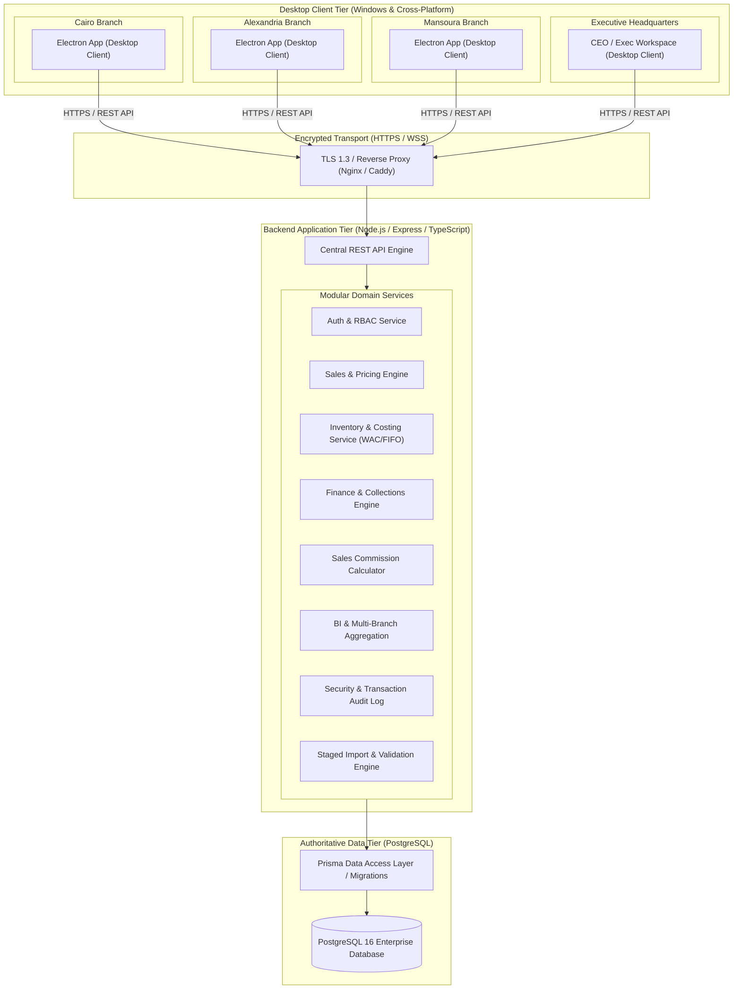
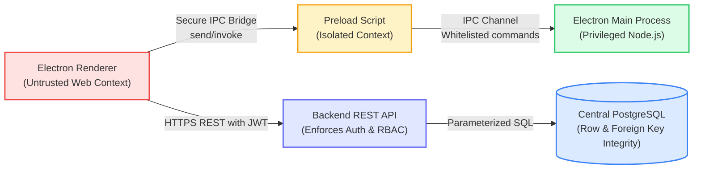

# System Architecture & Technical Design

## 1. High-Level Architecture Topology

The enterprise system implements a 3-tier architecture ensuring data consistency across the Cairo, Alexandria, and Mansoura operations while enforcing strict separation of concerns and defense-in-depth security.

### 1.1 Client Tier (Desktop Application)
- **Host Runtime**: Electron framework embedding Chromium and Node.js.
- **UI Framework**: React 18, TypeScript, Tailwind CSS, Lucide Icons, Recharts for analytics data visualization.
- **Process Separation**:
  - `Main Process`: Handles window lifecycle, native menus, secure hardware acceleration, OS print/export dialogs.
  - `Preload Script`: Exposes a strictly whitelisted, sandboxed IPC bridge (`window.electronAPI`) using Electron's `contextBridge.exposeInMainWorld`.
  - `Renderer Process`: Runs React UI with zero Node.js access (`nodeIntegration: false`, `contextIsolation: true`).
  - **Zero Direct Database Connections**: The desktop client NEVER connects directly to PostgreSQL and possesses no database credentials. All operations travel through authenticated HTTPS endpoints.

### 1.2 Application Server Tier (Backend API)
- **Runtime**: Node.js v22 LTS with TypeScript.
- **Web Engine**: Express.js REST API with modular routers and strict request/response contracts.
- **Validation**: Zod schema validation for all incoming request payloads, URL parameters, and query parameters before business logic execution.
- **Authentication**: JWT bearer tokens with short expiry (15m access token, 7d refresh token) and branch-scoped claims.
- **Multi-Branch Isolation Middleware**: Enforces that non-CEO users are restricted to their authorized branch ID. Injections or URL manipulations attempting to access other branches are immediately rejected with `403 Forbidden`.

### 1.3 Authoritative Data Tier (PostgreSQL)
- **Relational Integrity**: Enforced foreign keys, unique constraints, and check constraints.
- **Financial Exactness**: All monetary values stored as `NUMERIC(14, 2)`.
- **Atomic Operations**: PostgreSQL multi-table ACID transactions for all inventory dispatches, invoice issuances, and payment allocations.
- **Timezone**: All timestamp fields recorded in UTC (`TIMESTAMP WITH TIME ZONE`). Presentation converted to Cairo local time (`Africa/Cairo`, UTC+2 / UTC+3 DST).

---

## 2. Security Trust Boundaries

1. **Renderer $\to$ Preload Boundary**: The renderer is considered untrusted. No arbitrary shell commands, direct disk writes, or raw socket connections are permissible.
2. **Client $\to$ Backend Boundary**: The client provides a JWT token. The backend verifies signature, expiration, active user status, and extracts user ID, role, and branch assignment. Client-provided branch IDs are ignored for branch-restricted users.
3. **Backend $\to$ Database Boundary**: All queries are executed through Prisma ORM using prepared statements. Raw SQL string concatenation is strictly forbidden.

---

## 3. Deliberate Offline Synchronization Architecture (Future Roadmap)

If branch internet connectivity drops, the system displays an explicit connection warning rather than silently diverging into unsynchronized local databases.

For future offline tolerance, the proposed architecture follows a **Conflict-Free Staged Replication Protocol**:
1. **Local SQLite Cache**: Encrypted local cache for read-only master data (product catalog, active customer directory, price lists).
2. **Outbox Queue**: Local store of draft orders and receipts with UUIDv4 client identifiers and local increment sequences.
3. **Reconciliation Server**: When connectivity restores:
   - Orders are validated sequentially against available inventory at the time of sync.
   - If stockout occurred while offline, the order transitions to `PENDING_RESOLUTION` requiring branch manager review.
   - Financial allocations are stamped with central server timestamp to preserve FIFO order.
