# Database Architecture & Entity-Relationship Schema

## 1. Entity-Relationship Diagram (ERD)

```mermaid
erDiagram
    BRANCHES ||--o{ USERS : "assigned to"
    BRANCHES ||--o{ SALES_REPRESENTATIVES : "assigned to"
    BRANCHES ||--o{ WAREHOUSES : "operates"
    BRANCHES ||--o{ CUSTOMERS : "serves"
    BRANCHES ||--o{ SALES_INVOICES : "originates"
    BRANCHES ||--o{ SALES_RETURNS : "processes"
    BRANCHES ||--o{ EXPENSES : "incurs"
    BRANCHES ||--o{ BRANCH_BUDGETS : "allocated"

    ROLES ||--o{ USERS : "defines permissions for"
    USERS ||--o{ AUDIT_LOGS : "performed by"
    USERS ||--o{ DISCOUNT_APPROVALS : "approved by"
    USERS ||--o{ COMMISSION_ADJUSTMENTS : "adjusted by"

    SALES_REPRESENTATIVES ||--o{ SALES_TARGETS : "assigned"
    SALES_REPRESENTATIVES ||--o{ SALES_INVOICES : "generates"
    SALES_REPRESENTATIVES ||--o{ COMMISSION_CALCULATIONS : "calculated for"

    PRODUCT_CATEGORIES ||--o{ PRODUCTS : "groups"
    UNITS_OF_MEASURE ||--o{ PRODUCTS : "measures"
    SUPPLIERS ||--o{ PRODUCTS : "supplies"
    SUPPLIERS ||--o{ PURCHASE_ORDERS : "receives"
    SUPPLIERS ||--o{ PURCHASE_INVOICES : "bills"

    CUSTOMERS ||--o{ SALES_INVOICES : "billed"
    CUSTOMERS ||--o{ CUSTOMER_PAYMENTS : "pays"
    CUSTOMERS ||--o{ CREDIT_NOTES : "credited"

    SALES_INVOICES ||--o{ SALES_INVOICE_LINES : "contains"
    SALES_INVOICES ||--o{ PAYMENT_ALLOCATIONS : "settled by"
    SALES_INVOICES ||--o{ DELIVERIES : "dispatched via"
    SALES_INVOICES ||--o{ SALES_RETURNS : "referenced by"

    SALES_RETURNS ||--o{ SALES_RETURN_LINES : "contains"
    RETURN_REASONS ||--o{ SALES_RETURN_LINES : "categorizes"

    PURCHASE_INVOICES ||--o{ PURCHASE_INVOICE_LINES : "contains"

    WAREHOUSES ||--o{ INVENTORY_MOVEMENTS : "stores"
    WAREHOUSES ||--o{ INVENTORY_BATCHES : "contains"
    WAREHOUSES ||--o{ STOCK_ADJUSTMENTS : "adjusted in"

    PRODUCTS ||--o{ SALES_INVOICE_LINES : "itemized in"
    PRODUCTS ||--o{ SALES_RETURN_LINES : "itemized in"
    PRODUCTS ||--o{ PURCHASE_INVOICE_LINES : "itemized in"
    PRODUCTS ||--o{ INVENTORY_MOVEMENTS : "tracked in"
    PRODUCTS ||--o{ INVENTORY_BATCHES : "batched in"

    CUSTOMER_PAYMENTS ||--o{ PAYMENT_ALLOCATIONS : "allocated across"
    EXPENSE_CATEGORIES ||--o{ EXPENSES : "categorizes"
    COMMISSION_POLICIES ||--o{ COMMISSION_CALCULATIONS : "applies"
```

---

## 2. Comprehensive Entity Specifications

All primary keys use UUID v4 strings for distributed uniqueness and secure isolation.  
All currency and quantitative financial fields use PostgreSQL `NUMERIC(14, 2)` or `NUMERIC(12, 4)` for high-precision unit costing.

### A. Users & Organization
- `branches`: `id`, `code` (CAI, ALX, MNS), `name_en`, `name_ar`, `address`, `phone`, `color_code`, `created_at`.
- `roles`: `id`, `name` (CEO, BRANCH_MANAGER, ACCOUNTANT, INVENTORY_STAFF, SALES_REP, ADMIN), `description`, `permissions` (JSONB array).
- `users`: `id`, `branch_id` (NULL for CEO/global admin), `role_id`, `username`, `email`, `password_hash`, `full_name`, `phone`, `is_active`, `created_at`, `updated_at`.
- `sales_representatives`: `id`, `branch_id`, `user_id` (optional link), `code`, `name`, `phone`, `email`, `hire_date`, `is_active`, `commission_rate` (default 0.0200 = 2%), `created_at`.
- `sales_targets`: `id`, `sales_representative_id`, `branch_id`, `period_year`, `period_month`, `target_amount` (`NUMERIC(14, 2)`), `target_type` (GROSS_SALES, NET_SALES), `notes`, `created_at`.

### B. Master Catalog & Supply Chain
- `product_categories`: `id`, `code`, `name_en`, `name_ar`, `description`, `created_at`.
- `units_of_measure`: `id`, `code` (CARTON, BOTTLE, PACK, KG), `name_en`, `name_ar`.
- `suppliers`: `id`, `code`, `company_name`, `tax_id`, `commercial_reg`, `payment_terms_days`, `contact_name`, `phone`, `email`, `address`, `city`, `is_active`, `created_at`.
- `products`: `id`, `category_id`, `uom_id`, `supplier_id`, `sku`, `barcode`, `name_en`, `name_ar`, `brand`, `case_size`, `reorder_point`, `cost_price` (`NUMERIC(12, 4)`), `selling_price` (`NUMERIC(14, 2)`), `min_price` (`NUMERIC(14, 2)`), `is_active`, `requires_expiry_tracking` (BOOLEAN), `created_at`, `updated_at`.
- `customers`: `id`, `branch_id`, `code`, `name`, `customer_type` (SUPERMARKET, WHOLESALER, GROCERY), `tax_id`, `phone`, `address`, `credit_limit` (`NUMERIC(14, 2)`), `credit_days`, `is_active`, `created_at`.
- `warehouses`: `id`, `branch_id`, `code`, `name`, `location`, `capacity_sqm`, `is_active`.

### C. Sales & Invoicing
- `sales_invoices`: `id`, `invoice_number`, `branch_id`, `customer_id`, `sales_representative_id`, `invoice_date`, `due_date`, `gross_amount` (`NUMERIC(14, 2)`), `discount_amount` (`NUMERIC(14, 2)`), `tax_amount` (`NUMERIC(14, 2)`), `net_amount` (`NUMERIC(14, 2)`), `cogs_amount` (`NUMERIC(14, 2)`), `paid_amount` (`NUMERIC(14, 2)`), `balance_due` (`NUMERIC(14, 2)`), `payment_status` (UNPAID, PARTIAL, PAID), `status` (DRAFT, ISSUED, CANCELED), `notes`, `created_at`, `updated_at`.
- `sales_invoice_lines`: `id`, `sales_invoice_id`, `product_id`, `quantity`, `unit_price` (`NUMERIC(14, 2)`), `unit_cost` (`NUMERIC(12, 4)`), `discount_percent` (`NUMERIC(5, 2)`), `discount_amount` (`NUMERIC(14, 2)`), `line_total` (`NUMERIC(14, 2)`), `line_cogs` (`NUMERIC(14, 2)`), `created_at`.
- `sales_returns`: `id`, `return_number`, `sales_invoice_id`, `branch_id`, `customer_id`, `return_date`, `total_amount` (`NUMERIC(14, 2)`), `total_cost` (`NUMERIC(14, 2)`), `status` (PENDING, APPROVED, REJECTED), `approved_by_user_id`, `notes`, `created_at`.
- `sales_return_lines`: `id`, `sales_return_id`, `product_id`, `return_reason_id`, `quantity`, `unit_price`, `unit_cost`, `line_total`, `line_cost`, `stock_disposition` (RETURN_TO_STOCK, QUARANTINE_DAMAGED, SCRAPPED).
- `discount_approvals`: `id`, `sales_invoice_id`, `requested_by_user_id`, `approved_by_user_id`, `discount_percent`, `discount_amount`, `status` (PENDING, APPROVED, REJECTED), `reason`, `action_date`.

### D. Inventory & Costing
- `inventory_batches`: `id`, `product_id`, `warehouse_id`, `batch_number`, `manufacture_date`, `expiry_date`, `quantity_received`, `quantity_available`, `unit_cost` (`NUMERIC(12, 4)`), `status` (ACTIVE, EXPIRED, DEPLETED), `created_at`.
- `inventory_movements`: `id`, `warehouse_id`, `product_id`, `batch_id`, `movement_type` (RECEIPT, DISPATCH, RETURN, ADJUSTMENT_POSITIVE, ADJUSTMENT_NEGATIVE, TRANSFER_IN, TRANSFER_OUT), `reference_type` (PURCHASE_INVOICE, SALES_INVOICE, SALES_RETURN, STOCK_TRANSFER, STOCK_ADJUSTMENT), `reference_id`, `quantity_change`, `unit_cost` (`NUMERIC(12, 4)`), `total_cost` (`NUMERIC(14, 2)`), `balance_after`, `timestamp`, `created_by_user_id`.
- `stock_transfers`: `id`, `transfer_number`, `from_warehouse_id`, `to_warehouse_id`, `status` (DRAFT, IN_TRANSIT, COMPLETED, CANCELED), `sent_date`, `received_date`, `notes`.
- `stock_adjustments`: `id`, `warehouse_id`, `product_id`, `adjustment_type` (DAMAGE, COUNT_VARIANCE, EXPIRY), `quantity_delta`, `unit_cost`, `approved_by_user_id`, `notes`, `timestamp`.

### E. Purchasing & Vendors
- `purchase_orders`: `id`, `po_number`, `supplier_id`, `warehouse_id`, `order_date`, `expected_delivery_date`, `total_amount` (`NUMERIC(14, 2)`), `status` (DRAFT, ORDERED, RECEIVED, CANCELED).
- `purchase_invoices`: `id`, `pi_number`, `supplier_id`, `purchase_order_id`, `warehouse_id`, `invoice_date`, `total_amount`, `paid_amount`, `payment_status` (UNPAID, PARTIAL, PAID), `status` (DRAFT, POSTED).
- `purchase_invoice_lines`: `id`, `purchase_invoice_id`, `product_id`, `quantity`, `unit_cost` (`NUMERIC(12, 4)`), `line_total` (`NUMERIC(14, 2)`), `batch_number`, `expiry_date`.

### F. Finance, Collections & Expenses
- `customer_payments`: `id`, `payment_number`, `customer_id`, `branch_id`, `payment_date`, `amount` (`NUMERIC(14, 2)`), `payment_method` (CASH, BANK_TRANSFER, CHEQUE), `reference_number`, `unallocated_amount` (`NUMERIC(14, 2)`), `notes`, `created_by_user_id`, `created_at`.
- `payment_allocations`: `id`, `customer_payment_id`, `sales_invoice_id`, `allocated_amount` (`NUMERIC(14, 2)`), `created_at`.
- `credit_notes`: `id`, `credit_note_number`, `customer_id`, `sales_return_id`, `branch_id`, `amount`, `issue_date`, `remaining_credit`, `status` (OPEN, APPLIED, REFUNDED).
- `expense_categories`: `id`, `code`, `name_en`, `name_ar`, `is_operating_expense` (BOOLEAN).
- `expenses`: `id`, `branch_id`, `category_id`, `expense_date`, `amount` (`NUMERIC(14, 2)`), `recipient_or_vendor`, `payment_method`, `approved_by_user_id`, `notes`, `receipt_ref`, `created_at`.
- `branch_budgets`: `id`, `branch_id`, `category_id`, `period_year`, `period_month`, `budget_amount` (`NUMERIC(14, 2)`), `created_at`.

### G. Commissions & Operations
- `commission_policies`: `id`, `name`, `code` (POLICY_GROSS, POLICY_NET_AFTER_DISCOUNT, POLICY_NET_AFTER_RETURNS, POLICY_PROFIT_BASED), `description`, `is_default`, `rate_percentage` (`NUMERIC(5, 2)`), `is_active`.
- `commission_calculations`: `id`, `sales_representative_id`, `period_year`, `period_month`, `policy_id`, `eligible_base_amount` (`NUMERIC(14, 2)`), `applied_rate` (`NUMERIC(5, 2)`), `calculated_commission` (`NUMERIC(14, 2)`), `recorded_commission` (`NUMERIC(14, 2)`), `discrepancy_amount` (`NUMERIC(14, 2)`), `status` (DRAFT, APPROVED, PAID), `approved_by_user_id`, `notes`, `calculated_at`.
- `commission_adjustments`: `id`, `commission_calculation_id`, `adjustment_amount` (`NUMERIC(14, 2)`), `reason`, `authorized_by_user_id`, `created_at`.
- `deliveries`: `id`, `sales_invoice_id`, `branch_id`, `scheduled_date`, `actual_delivery_date`, `status` (SCHEDULED, IN_TRANSIT, DELIVERED, FAILED, DELAYED), `delay_reason`, `driver_name`, `vehicle_plate`, `transport_cost` (`NUMERIC(14, 2)`).
- `return_reasons`: `id`, `code`, `name_en`, `name_ar`, `requires_manager_approval` (BOOLEAN).
- `operational_alerts`: `id`, `branch_id`, `alert_type` (DUPLICATE_INVOICE, LOW_STOCK, EXPIRY_WARNING, UNALLOCATED_PAYMENT, UNAPPROVED_DISCOUNT, TARGET_RISK), `severity` (INFO, WARNING, CRITICAL), `title`, `description`, `is_resolved`, `created_at`.
- `audit_logs`: `id`, `user_id`, `branch_id`, `action` (CREATE, UPDATE, DELETE, APPROVE, EXPORT, LOGIN), `entity_name`, `entity_id`, `details` (JSONB), `ip_address`, `timestamp`.
- `import_jobs`: `id`, `filename`, `job_type` (INVOICES, PRODUCTS, CUSTOMERS), `total_rows`, `imported_rows`, `rejected_rows`, `status` (PENDING, VALIDATING, COMMITTED, FAILED), `user_id`, `created_at`.
- `import_errors`: `id`, `import_job_id`, `row_number`, `field_name`, `raw_value`, `error_message`, `created_at`.
